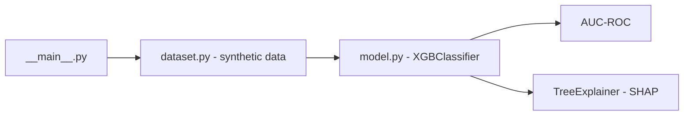

# previsor-inadimplencia-xgboost

**English** · [Português (Brasil)](README.md)

[](#) [](#) [](#) [](#) [](#) [](LICENSE)

## What it is

Predicts **default** (a client stops paying) with **XGBoost**, using a **deterministic synthetic dataset** (fixed `random_state`) of 5,000 records and 8 financial features. It trains the model, evaluates with **AUC-ROC** and explains predictions with **SHAP**. It is an educational ML lab focused on modeling and explainability.

## Status

An ML lab, working and tested (9 tests). Real metrics run by the agent on 31/10/2026.

## Features

- **Deterministic synthetic dataset** (`gerar_dataset_sintetico`): 5,000 records, 8 features (income, age, loan amount, dependents, score, credit-limit usage, late payments, account age), `random_state=42`.
- **XGBoost model** (`XGBClassifier`) with a stratified 80/20 split.
- **Evaluation**: AUC-ROC on the test set.
- **SHAP explainability** (`TreeExplainer`): local feature importance.
- **CLI**: runs the pipeline and prints AUC-ROC plus a SHAP example.

## Architecture

A `previsor_inadimplencia` package with `dataset.py` (data generation) and `model.py` (training + SHAP). `__main__.py` orchestrates: generate data → train → evaluate → explain.



## Stack

- Python ≥ 3.10
- xgboost ≥ 1.7, shap ≥ 0.43, pandas ≥ 2.0, scikit-learn ≥ 1.3
- pytest (dev)

## Repository layout

```
previsor-inadimplencia-xgboost/
├── pyproject.toml · BRIEF.md
├── src/previsor_inadimplencia/
│   ├── dataset.py      # deterministic synthetic data
│   ├── model.py        # XGBoost + SHAP
│   └── __main__.py     # CLI pipeline
├── tests/test_model.py
└── LICENSE             # MIT
```

## Prerequisites and installation

Python ≥ 3.10.

```bash
pip install -e .
```

## How to run

```bash
PYTHONPATH=src python -m previsor_inadimplencia
```

Real result (verified by the agent):

```text
AUC-ROC (test): 0.8885
Train: 3750 | Test: 1250 | Features: 8
Example SHAP explanation (first sample):
  utilizacao_limite: +1.0637   ← highest local weight
  num_atrasos_12m: +0.9015
  tempo_conta_anos: +0.2664
  ...
```

## Tests and quality

Real command (verified by the agent):

```bash
PYTHONPATH=src python -m pytest tests/test_model.py -q
# 9 passed
```

## Technical decisions and trade-offs

- **Deterministic synthetic data**: reproducible and free of real-data leakage; in exchange, it does not reflect a real client base.
- **XGBoost + SHAP**: a competitive model with good local explanations; the cost is heavier library dependencies.
- **AUC-ROC as the metric**: suitable for imbalanced classes and sensitive to prediction order.

## Known limitations and roadmap

- Trained on synthetic data — **do not** use it for real credit decisions without retraining on valid data.
- No explicit imbalance handling beyond the stratified split; no probability calibration.
- The SHAP explanation covers a single sample, not the whole set.

## Development process

An individual project by Kelvin Oliveira, built with orchestrated AI agents and reviewed by the author. The modeling, the explainability pipeline and the review are the author's.

## License and author

MIT — Copyright (c) 2026 Kelvin Rebelo de Oliveira.

**Author**: [Kelvin Oliveira](https://github.com/KelvinOliveiraCode) · [Portfolio](https://kelvinoliveiracode.github.io/portfolio/)
