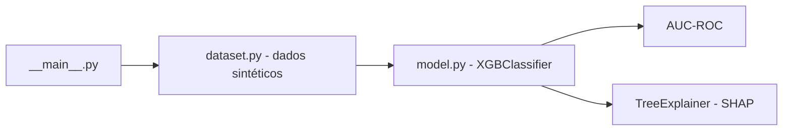

# previsor-inadimplencia-xgboost

[English](README.en.md) · **Português (Brasil)**

[](#) [](#) [](#) [](#) [](#) [](LICENSE)

## O que é

Prevê **inadimplência** (cliente deixa de pagar) com **XGBoost**, usando um **dataset sintético determinístico** (`random_state` fixo) de 5.000 registros e 8 features financeiras. Treina o modelo, avalia com **AUC-ROC** e explica as predições com **SHAP**. É um laboratório educacional de ML com foco em modelagem e explicabilidade.

## Status

Laboratório de ML, funcional e testado (9 testes). Métricas reais executadas pelo agente em 31/10/2026.

## Funcionalidades

- **Dataset sintético determinístico** (`gerar_dataset_sintetico`): 5.000 registros, 8 features (renda, idade, valor do empréstimo, dependentes, score, utilização de limite, atrasos, tempo de conta), `random_state=42`.
- **Modelo XGBoost** (`XGBClassifier`) com split 80/20 estratificado.
- **Avaliação**: AUC-ROC sobre o teste.
- **Explicabilidade SHAP** (`TreeExplainer`): importância local das features.
- **CLI**: roda o pipeline e imprime AUC-ROC + exemplo de explicação SHAP.

## Arquitetura

Pacote `previsor_inadimplencia` com `dataset.py` (geração de dados) e `model.py` (treino + SHAP). O `__main__.py` orquestra: gera dados → treina → avalia → explica.



## Stack

- Python ≥ 3.10
- xgboost ≥ 1.7, shap ≥ 0.43, pandas ≥ 2.0, scikit-learn ≥ 1.3
- pytest (dev)

## Estrutura do repositório

```
previsor-inadimplencia-xgboost/
├── pyproject.toml · BRIEF.md
├── src/previsor_inadimplencia/
│   ├── dataset.py      # dados sintéticos determinísticos
│   ├── model.py        # XGBoost + SHAP
│   └── __main__.py     # pipeline de CLI
├── tests/test_model.py
└── LICENSE             # MIT
```

## Pré-requisitos e instalação

Python ≥ 3.10.

```bash
pip install -e .
```

## Como executar

```bash
PYTHONPATH=src python -m previsor_inadimplencia
```

Resultado real (verificado pelo agente):

```text
AUC-ROC (teste): 0.8885
Treino: 3750 | Teste: 1250 | Features: 8
Exemplo de explicação SHAP (primeira amostra):
  utilizacao_limite: +1.0637   ← maior peso local
  num_atrasos_12m: +0.9015
  tempo_conta_anos: +0.2664
  ...
```

## Testes e qualidade

Comando real (verificado pelo agente):

```bash
PYTHONPATH=src python -m pytest tests/test_model.py -q
# 9 passed
```

## Decisões técnicas e trade-offs

- **Dados sintéticos determinísticos**: reprodutível e sem vazamento de dados reais; em troca, não refletem um cliente real.
- **XGBoost + SHAP**: modelo competitivo com boas explicações locais; o custo é a dependência de bibliotecas mais pesadas.
- **AUC-ROC como métrica**: adequado a classes desbalanceadas, sensível à ordem das predições.

## Limitações conhecidas e roadmap

- Modelo treinado em dados sintéticos — **não** deve ser usado para decisões reais de crédito sem retreinar com dados válidos.
- Sem tratamento explícito de desbalanceamento além do split estratificado; sem calibração de probabilidade.
- A explicação SHAP é sobre uma amostra de exemplo, não sobre todo o conjunto.

## Processo de desenvolvimento

Projeto individual de Kelvin Oliveira, construído com agentes de IA orquestrados e revisado pelo autor. A modelagem, o pipeline de explicabilidade e a revisão são do autor.

## Licença e autor

MIT — Copyright (c) 2026 Kelvin Rebelo de Oliveira.

**Autor**: [Kelvin Oliveira](https://github.com/KelvinOliveiraCode) · [Portfólio](https://kelvinoliveiracode.github.io/portfolio/)
